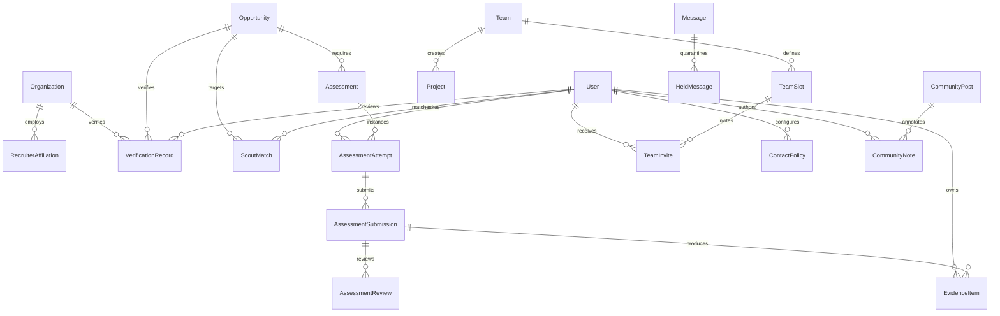

# OrbitMod V5 Master Implementation Plan (Stage 2)

## Executive Architecture Summary

OrbitMod V5 extends the existing Orbit platform with four specialized, interconnected coworker modules ("The Four Dots"):
1. **AVIS** — Trust & Verification
2. **SCOUT** — Discovery, Matching & Teams
3. **QUILL** — Skills, Assessments & Evidence
4. **RELAY** — Community, Messaging, Safety & Community Notes

Shared capabilities (**Spaces**, **Opportunities**, **Evidence Passport**, **Teams**, **Projects**, **Notifications**, **Audit Log**) provide the shared context across the Four Dots.

### The Core Loop
$$\text{Discover} \to \text{Verify} \to \text{Prove} \to \text{Match} \to \text{Collaborate} \to \text{Build Evidence}$$
$$\text{(Space} \to \text{Opportunity} \to \text{Avis} \to \text{Scout} \to \text{Quill} \to \text{Evidence} \to \text{Team} \to \text{Relay} \to \text{Project} \to \text{Evidence Passport)}$$

---

## 1. Data Model & Schema Extensions

The existing schema in `prisma/schema.prisma` already defines core models (`User`, `Profile`, `Skill`, `Organization`, `Opportunity`, `Project`, `Community`, `Conversation`, `Message`, `Notification`, `AuditLog`).

OrbitMod V5 introduces **NEW** models that link directly to these existing entities without introducing duplicate tables or ORMs.

### 1.1 New Entities & Relationships



### 1.2 Prisma Model Definitions (New Additions)

```prisma
// ─── AVIS ENUMS & MODELS ───────────────────────────────────────────────────────

enum AvisResourceType {
  ORGANIZATION
  RECRUITER_AFFILIATION
  OPPORTUNITY
}

enum AvisVerificationState {
  UNVERIFIED
  LIMITED_EVIDENCE
  NEEDS_REVIEW
  SUSPICIOUS
  VERIFIED
}

enum AvisAppealStatus {
  PENDING
  APPROVED
  REJECTED
}

model VerificationRecord {
  id                   String                @id @default(cuid())
  resourceType         AvisResourceType
  resourceId           String                // maps to Organization.id, Opportunity.id, etc.
  state                AvisVerificationState @default(UNVERIFIED)
  evidence             Json                  @default("[]") // [{ id, type, source, value, checkedAt, verified }]
  reasons              Json                  @default("[]") // [{ code, message, severity }]
  reviewerId           String?
  checkedAt            DateTime              @default(now())
  expiresAt            DateTime?
  version              Int                   @default(1)
  domainChallengeToken String?               @unique
  domainChallengeHost  String?
  domainChallengeExpiresAt DateTime?

  reviewer             User?                 @relation("VerificationReviewer", fields: [reviewerId], references: [id], onDelete: SetNull)
  appeals              VerificationAppeal[]

  @@unique([resourceType, resourceId])
  @@index([state])
  @@index([resourceId])
}

model VerificationAppeal {
  id                   String           @id @default(cuid())
  verificationRecordId String
  requesterId          String
  reason               String           @db.Text
  evidenceUrls         Json             @default("[]")
  status               AvisAppealStatus @default(PENDING)
  reviewerId           String?
  reviewerNotes        String?          @db.Text
  createdAt            DateTime         @default(now())
  resolvedAt           DateTime?

  verificationRecord   VerificationRecord @relation(fields: [verificationRecordId], references: [id], onDelete: Cascade)
  requester            User               @relation("AppealRequester", fields: [requesterId], references: [id], onDelete: Cascade)
  reviewer             User?              @relation("AppealReviewer", fields: [reviewerId], references: [id], onDelete: SetNull)

  @@index([verificationRecordId])
  @@index([status])
}

model RecruiterAffiliation {
  id             String   @id @default(cuid())
  organizationId String
  userId         String
  emailDomain    String
  isVerified     Boolean  @default(false)
  verifiedAt     DateTime?
  expiresAt      DateTime?
  createdAt      DateTime @default(now())

  organization   Organization @relation(fields: [organizationId], references: [id], onDelete: Cascade)
  user           User         @relation(fields: [userId], references: [id], onDelete: Cascade)

  @@unique([organizationId, userId])
  @@index([emailDomain])
}

// ─── SCOUT ENUMS & MODELS ─────────────────────────────────────────────────────

enum ScoutTargetType {
  OPPORTUNITY
  TEAM_SLOT
  PERSON
}

enum ScoutMatchStatus {
  NEW
  VIEWED
  ACCEPTED
  DECLINED
}

model ScoutMatch {
  id                  String           @id @default(cuid())
  candidateId         String
  targetType          ScoutTargetType
  targetId            String           // Opportunity.id or TeamSlot.id
  score               Float            // Total score: 0.00 to 1.00
  skillCoverage       Float            // 0.0 to 1.0 (weight 0.35)
  availabilityOverlap Float            // 0.0 to 1.0 (weight 0.25)
  interestMatch       Float            // 0.0 to 1.0 (weight 0.20)
  timezoneCompat      Float            // 0.0 to 1.0 (weight 0.10)
  verifiedEvidence    Float            // 0.0 to 1.0 (weight 0.10)
  breakdown           Json             // Structured component metrics
  explanation         String           @db.Text // Deterministic factual explanation
  isAIAssisted        Boolean          @default(false)
  status              ScoutMatchStatus @default(NEW)
  exposureCount       Int              @default(1)
  createdAt           DateTime         @default(now())
  updatedAt           DateTime         @updatedAt

  candidate           User             @relation(fields: [candidateId], references: [id], onDelete: Cascade)

  @@unique([candidateId, targetType, targetId])
  @@index([candidateId])
  @@index([score])
}

enum TeamStatus {
  FORMING
  ACTIVE
  COMPLETED
  ARCHIVED
}

model Team {
  id              String      @id @default(cuid())
  name            String
  description     String      @db.Text
  opportunityId   String?
  sponsorId       String
  organizationId  String?
  projectId       String?     @unique
  status          TeamStatus  @default(FORMING)
  workspaceClosed Boolean     @default(true)
  createdAt       DateTime    @default(now())
  updatedAt       DateTime    @updatedAt

  sponsor         User        @relation("TeamSponsor", fields: [sponsorId], references: [id], onDelete: Cascade)
  organization    Organization? @relation(fields: [organizationId], references: [id], onDelete: SetNull)
  slots           TeamSlot[]
  invites         TeamInvite[]

  @@index([sponsorId])
  @@index([status])
}

model TeamSlot {
  id                  String   @id @default(cuid())
  teamId              String
  skillTag            String
  minHoursPerWeek     Int      @default(10)
  assignedCandidateId String?
  isFilled            Boolean  @default(false)
  createdAt           DateTime @default(now())

  team                Team     @relation(fields: [teamId], references: [id], onDelete: Cascade)
  assignedCandidate   User?    @relation(fields: [assignedCandidateId], references: [id], onDelete: SetNull)
  invites             TeamInvite[]

  @@index([teamId])
}

enum TeamInviteStatus {
  PENDING
  ACCEPTED
  DECLINED
  EXPIRED
}

model TeamInvite {
  id          String           @id @default(cuid())
  teamId      String
  slotId      String
  candidateId String
  status      TeamInviteStatus @default(PENDING)
  expiresAt   DateTime
  createdAt   DateTime         @default(now())
  respondedAt DateTime?

  team        Team             @relation(fields: [teamId], references: [id], onDelete: Cascade)
  slot        TeamSlot         @relation(fields: [slotId], references: [id], onDelete: Cascade)
  candidate   User             @relation(fields: [candidateId], references: [id], onDelete: Cascade)

  @@unique([teamId, slotId, candidateId])
  @@index([candidateId])
}

// ─── QUILL ENUMS & MODELS ─────────────────────────────────────────────────────

enum QuillAssessmentType {
  ARTIFACT_TASK
  SQL_TASK
}

enum QuillAttemptState {
  CREATED
  STARTED
  SUBMITTED
  AUTO_CHECKED
  IN_REVIEW
  RELEASED
  SHARED
  EXPIRED
  WITHDRAWN
}

model Assessment {
  id              String              @id @default(cuid())
  opportunityId   String?
  creatorId       String
  title           String
  description     String              @db.Text
  type            QuillAssessmentType @default(ARTIFACT_TASK)
  instructions    String              @db.Text
  rubric          Json                // [{ id, label, weight, maxScore, description }]
  version         Int                 @default(1)
  durationMinutes Int?
  isActive        Boolean             @default(true)
  createdAt       DateTime            @default(now())
  updatedAt       DateTime            @updatedAt

  opportunity     Opportunity?        @relation(fields: [opportunityId], references: [id], onDelete: SetNull)
  attempts        AssessmentAttempt[]

  @@index([opportunityId])
}

model AssessmentAttempt {
  id           String            @id @default(cuid())
  assessmentId String
  candidateId  String
  state        QuillAttemptState @default(CREATED)
  startedAt    DateTime?
  expiresAt    DateTime?
  submittedAt  DateTime?
  releasedAt   DateTime?
  createdAt    DateTime          @default(now())
  updatedAt    DateTime          @updatedAt

  assessment   Assessment        @relation(fields: [assessmentId], references: [id], onDelete: Cascade)
  candidate    User              @relation(fields: [candidateId], references: [id], onDelete: Cascade)
  submission   AssessmentSubmission?

  @@index([candidateId])
  @@index([assessmentId])
  @@index([state])
}

model AssessmentSubmission {
  id          String    @id @default(cuid())
  attemptId   String    @unique
  artifactUrl String?
  content     String?   @db.Text
  shingleHash String?   // n-gram fingerprint for similarity check
  metadata    Json      @default("{}") // { filename, size, mimeType, linkStatus }
  submittedAt DateTime  @default(now())

  attempt     AssessmentAttempt  @relation(fields: [attemptId], references: [id], onDelete: Cascade)
  review      AssessmentReview?
  evidence    EvidenceItem?
}

model AssessmentReview {
  id                   String   @id @default(cuid())
  submissionId         String   @unique
  reviewerId           String?  // null if AI-draft only
  rubricVersion        Int
  criteriaScores       Json     // [{ id, score, max, evidenceQuote, rationale, confidence }]
  overallScore         Float
  summary              String   @db.Text
  isAIAssisted         Boolean  @default(false)
  humanReviewRequired  Boolean  @default(true)
  reviewerDisagreement Boolean  @default(false)
  createdAt            DateTime @default(now())
  updatedAt            DateTime @updatedAt

  submission           AssessmentSubmission @relation(fields: [submissionId], references: [id], onDelete: Cascade)
  reviewer             User?                @relation("ReviewerUser", fields: [reviewerId], references: [id], onDelete: SetNull)
}

model EvidenceItem {
  id                  String    @id @default(cuid())
  ownerId             String
  title               String
  skillId             String
  submissionId        String?   @unique
  artifactUrl         String?
  summary             String    @db.Text
  isPrivate           Boolean   @default(true)
  revocableShareToken String?   @unique
  shareTokenExpiresAt DateTime?
  createdAt           DateTime  @default(now())

  owner               User      @relation(fields: [ownerId], references: [id], onDelete: Cascade)
  skill               Skill     @relation(fields: [skillId], references: [id], onDelete: Cascade)
  submission          AssessmentSubmission? @relation(fields: [submissionId], references: [id], onDelete: SetNull)

  @@index([ownerId])
  @@index([skillId])
  @@index([revocableShareToken])
}

// ─── RELAY ENUMS & MODELS ─────────────────────────────────────────────────────

enum ContactPolicyMode {
  TEAM_ONLY
  APPLICATIONS_ONLY
  CONNECTIONS_ONLY
  EVERYONE_REQUEST
  NO_PROMOTIONS
}

model ContactPolicy {
  id        String            @id @default(cuid())
  userId    String            @unique
  mode      ContactPolicyMode @default(EVERYONE_REQUEST)
  updatedAt DateTime          @updatedAt

  user      User              @relation(fields: [userId], references: [id], onDelete: Cascade)
}

enum RelayRoutingDecision {
  DELIVER
  REQUEST_INBOX
  THROTTLE
  QUARANTINE
  REVIEW_OR_QUARANTINE
  REJECT
}

model HeldMessage {
  id                   String               @id @default(cuid())
  messageId            String               @unique
  recipientId          String
  senderId             String
  decision             RelayRoutingDecision
  reasonCode           String
  policyVersion        Int                  @default(1)
  restoredByRecipient  Boolean              @default(false)
  createdAt            DateTime             @default(now())

  recipient            User                 @relation("HeldRecipient", fields: [recipientId], references: [id], onDelete: Cascade)
  sender               User                 @relation("HeldSender", fields: [senderId], references: [id], onDelete: Cascade)

  @@index([recipientId])
  @@index([senderId])
}

enum CommunityNoteStatus {
  SUBMITTED
  EVIDENCE_CHECK
  NEEDS_REVIEW
  PUBLISHED_CONTEXT
  REJECTED
  APPEALED
  REVISED
  UPHELD
}

model CommunityNote {
  id                   String              @id @default(cuid())
  targetId             String              // postId or opportunityId
  targetType           String              // "POST" or "OPPORTUNITY"
  authorId             String
  claim                String              @db.Text
  context              String              @db.Text
  sourceUrls           Json                // string array of sources (minimum 1, 2 for facts)
  status               CommunityNoteStatus @default(SUBMITTED)
  policyVersion        Int                 @default(1)
  moderatorId          String?
  moderationNotes      String?             @db.Text
  moderatedAt          DateTime?
  organisationResponse String?             @db.Text
  respondedAt          DateTime?
  createdAt            DateTime            @default(now())
  updatedAt            DateTime            @updatedAt

  author               User                @relation("NoteAuthor", fields: [authorId], references: [id], onDelete: Cascade)
  moderator            User?               @relation("NoteModerator", fields: [moderatorId], references: [id], onDelete: SetNull)

  @@index([targetId])
  @@index([status])
}
```

---

## 2. State Machines & Legal Transitions

All state machines are implemented as deterministic pure functions with runtime validation.

### 2.1 AVIS Verification State Machine
```text
State Transitions:
  UNVERIFIED -> LIMITED_EVIDENCE (documents uploaded, pending domain/human check)
  UNVERIFIED -> NEEDS_REVIEW     (anomaly detected or check provider timeout)
  UNVERIFIED -> SUSPICIOUS       (look-alike domain or malicious link confirmed)

  LIMITED_EVIDENCE -> NEEDS_REVIEW (stale evidence or fee request pattern)
  LIMITED_EVIDENCE -> VERIFIED     (successful DNS TXT challenge OR human review decision ONLY)
  LIMITED_EVIDENCE -> SUSPICIOUS   (fraud indicators found)

  NEEDS_REVIEW -> VERIFIED         (human reviewer approval ONLY)
  NEEDS_REVIEW -> SUSPICIOUS       (human reviewer confirms violation)
  NEEDS_REVIEW -> UNVERIFIED       (rejected due to insufficient proof)

  VERIFIED -> NEEDS_REVIEW         (evidence expired OR recruiter affiliation changed)
  VERIFIED -> SUSPICIOUS           (risk trigger verified by reviewer)

  SUSPICIOUS -> NEEDS_REVIEW       (appeal submitted by subject)
  SUSPICIOUS -> UNVERIFIED         (appeal upheld by second reviewer)
```
*Crucial Rule*: `VERIFIED` can **ONLY** be reached via DNS TXT challenge or an authenticated human reviewer decision. AI output and automated rules can only transition to `NEEDS_REVIEW` or `SUSPICIOUS`.

### 2.2 QUILL Assessment Attempt State Machine
```text
State Transitions:
  CREATED -> STARTED               (candidate opens workspace; timer starts server-side)
  STARTED -> SUBMITTED             (candidate submits artifact before expiry)
  STARTED -> EXPIRED               (server-side deadline exceeded)
  STARTED -> WITHDRAWN             (candidate explicitly cancels attempt)

  SUBMITTED -> AUTO_CHECKED        (SSRF fetch, magic-byte inspection, shingle hash)
  AUTO_CHECKED -> IN_REVIEW        (AI advisory evaluation generated + placed in review queue)
  IN_REVIEW -> RELEASED            (human reviewer grades or approves scores)
  RELEASED -> SHARED               (candidate creates revocable share token for Evidence Passport)
```

### 2.3 RELAY Community Note State Machine
```text
State Transitions:
  SUBMITTED -> EVIDENCE_CHECK      (automated SSRF reachability + PII screening)
  EVIDENCE_CHECK -> NEEDS_REVIEW   (sources reachable, no doxxing; placed in moderator queue)
  EVIDENCE_CHECK -> REJECTED       (contains doxxing, PII, or zero reachable sources)

  NEEDS_REVIEW -> PUBLISHED_CONTEXT (human moderator approves context)
  NEEDS_REVIEW -> REJECTED         (moderator rejects with documented reason)

  PUBLISHED_CONTEXT -> APPEALED    (affected organization files structured objection)
  REJECTED -> APPEALED             (note author appeals rejection)

  APPEALED -> REVISED              (moderator adjusts wording based on org evidence)
  APPEALED -> UPHELD               (second moderator upholds original verdict)
```

---

## 3. Route & API Specifications

All endpoints follow Next.js App Router conventions with explicit Zod schema validation.

### 3.1 AVIS API Routes
- `POST /api/orbitmod/avis/challenges/dns`
  - Input: `{ organizationId: string, domain: string }`
  - Output: `{ token: string, hostRecord: string, expiresAt: string }`
- `POST /api/orbitmod/avis/challenges/verify`
  - Input: `{ organizationId: string }`
  - Action: Runs `dns.promises.resolveTxt`.
  - Output: `{ verified: boolean, state: AvisVerificationState, reasons: string[] }`
- `POST /api/orbitmod/avis/reviews/decision`
  - Input: `{ verificationRecordId: string, decision: "VERIFY" | "REJECT" | "SUSPECT", reason: string }`
  - Guard: Admin only, cannot review own affiliation.
  - Output: `{ record: VerificationRecord }`
- `POST /api/orbitmod/avis/appeals`
  - Input: `{ verificationRecordId: string, reason: string, evidenceUrls: string[] }`
  - Output: `{ appealId: string, status: "PENDING" }`

### 3.2 SCOUT API Routes
- `GET /api/orbitmod/scout/recommendations`
  - Query: `?type=OPPORTUNITIES|TEAMS|PEOPLE`
  - Action: Runs deterministic matching formula + exposure cap.
  - Output: `{ matches: ScoutMatch[] }`
- `POST /api/orbitmod/scout/teams`
  - Input: `{ name: string, description: string, opportunityId?: string, slots: [{ skillTag: string, minHoursPerWeek: number }] }`
  - Output: `{ team: Team, slots: TeamSlot[] }`
- `POST /api/orbitmod/scout/teams/[id]/invite`
  - Input: `{ slotId: string, candidateId: string }`
  - Output: `{ inviteId: string, status: "PENDING" }`
- `POST /api/orbitmod/scout/teams/invites/[id]/respond`
  - Input: `{ action: "ACCEPT" | "DECLINE" }`
  - Output: `{ status: "ACCEPTED" | "DECLINED" }`

### 3.3 QUILL API Routes
- `POST /api/orbitmod/quill/assessments`
  - Input: `{ title: string, instructions: string, rubric: RubricItem[], durationMinutes?: number }`
  - Output: `{ assessmentId: string, version: number }`
- `POST /api/orbitmod/quill/attempts/start`
  - Input: `{ assessmentId: string }`
  - Output: `{ attemptId: string, expiresAt: string }`
- `POST /api/orbitmod/quill/attempts/[id]/submit`
  - Input: `{ artifactUrl?: string, content?: string, metadata: object }`
  - Action: Magic bytes verification, SSRF safe fetch, shingle hash, idempotent write.
  - Output: `{ attemptId: string, state: "SUBMITTED" }`
- `POST /api/orbitmod/quill/reviews/evaluate`
  - Input: `{ submissionId: string }`
  - Action: Calls AI Gateway for advisory rubric scores; validates exact substring quotes.
  - Output: `{ review: AssessmentReview, humanReviewRequired: true }`
- `POST /api/orbitmod/quill/evidence/share`
  - Input: `{ evidenceId: string, expiresInDays?: number }`
  - Output: `{ shareToken: string, shareUrl: string }`
- `POST /api/orbitmod/quill/evidence/revoke`
  - Input: `{ evidenceId: string }`
  - Output: `{ revoked: true }`

### 3.4 RELAY API Routes
- `POST /api/orbitmod/relay/messages/route`
  - Input: `{ recipientId: string, content: string }`
  - Action: Evaluates 7-step deterministic routing table.
  - Output: `{ decision: RelayRoutingDecision, messageId?: string, reasonCode?: string }`
- `POST /api/orbitmod/relay/messages/held/[id]/restore`
  - Input: `{ action: "RESTORE" }`
  - Guard: Recipient only.
  - Output: `{ restored: true, message: Message }`
- `POST /api/orbitmod/relay/community-notes`
  - Input: `{ targetId: string, targetType: "POST" | "OPPORTUNITY", claim: string, context: string, sourceUrls: string[] }`
  - Output: `{ noteId: string, status: "SUBMITTED" }`
- `POST /api/orbitmod/relay/community-notes/[id]/moderate`
  - Input: `{ decision: "PUBLISH" | "REJECT", notes?: string }`
  - Guard: Moderator/Admin only.
  - Output: `{ status: CommunityNoteStatus }`

---

## 4. Event System & Message Bus

All events carry **identifiers only** (no private chat bodies, applicant resumes, or private evidence in event payloads). Handlers are strictly **idempotent**.

| Event Name | Payload Schema | Handlers & Actions |
|---|---|---|
| `opportunity.created` | `{ opportunityId, organizationId, timestamp }` | Avis triggers background URL/domain checks; Scout updates index. |
| `verification.requested` | `{ recordId, resourceType, resourceId }` | Generate challenge or notify verification review queue. |
| `verification.completed` | `{ recordId, state, reviewerId, timestamp }` | AuditLog written; Scout match weights update; notifications sent. |
| `match.generated` | `{ matchId, candidateId, targetId, score }` | Write ScoutMatch record; increment exposure counters. |
| `team.created` | `{ teamId, sponsorId, timestamp }` | Setup empty team slots; initialize private workspace lock. |
| `team.slot_filled` | `{ teamId, slotId, candidateId }` | Check if all slots filled; if complete, create linked Project. |
| `assessment.assigned` | `{ attemptId, candidateId, assessmentId }` | Send candidate task notification. |
| `assessment.submitted` | `{ submissionId, attemptId, timestamp }` | Queue for similarity check & advisory AI review draft. |
| `assessment.reviewed` | `{ reviewId, submissionId, reviewerId }` | Release score to candidate; enable Evidence creation. |
| `evidence.created` | `{ evidenceId, ownerId, skillId }` | Scout flags skill claim as "demonstrated"; Evidence Passport refreshed. |
| `message.sent` | `{ messageId, conversationId, senderId, recipientId }` | Supabase Realtime broadcast to authorized subscriber socket. |
| `message.quarantined` | `{ heldMessageId, senderId, recipientId, reasonCode }` | Place in recipient request inbox / review; notify sender with non-accusatory code. |
| `community_note.created`| `{ noteId, targetId, authorId }` | Automated link verification + moderation queue alert. |
| `appeal.created` | `{ appealId, type, requesterId }` | Route to independent reviewer not involved in original decision. |
| `project.completed` | `{ projectId, ownerId, deliverableId }` | Create VerifiedWorkRecord; release final project milestone. |

---

## 5. Resource-Level Authorization Matrix

Every read and write is guarded by resource-level ownership and role capabilities (default deny).

| Resource | Action | TALENT | FOUNDER / RECRUITER | ORG ADMIN | MODERATOR / ADMIN | Anonymous |
|---|---|---|---|---|---|---|
| **Verification Record** | Read Public Summary | Allow | Allow | Allow | Allow | Allow |
| **Verification Private Docs** | Read Evidence Files | Deny | Own org only | Own org only | Allow | Deny |
| **Verification Decision** | Mutate Status | Deny | Deny | Deny | Allow (cannot review self) | Deny |
| **Scout Recommendations** | Read Matches | Own matches only | Own postings only | Own postings only | Allow | Deny |
| **Assessment Attempt** | Start / Submit | Candidate only | Deny | Deny | Test mode only | Deny |
| **Assessment Review** | View AI Draft | Deny | If assigned reviewer | If assigned reviewer | Allow | Deny |
| **Evidence Record** | Read Default | Own only | Deny | Deny | Deny | Deny |
| **Evidence Record** | Read via Valid Token | Allow | Allow | Allow | Allow | Allow |
| **Team Workspace & Chat** | Read / Write Messages | Accepted members only | Accepted members only | Accepted members only | Audit only | Deny |
| **Held Message** | View / Restore | Recipient only | Recipient only | Recipient only | Case review only | Deny |
| **Community Note** | Create | Allow | Allow | Allow | Allow | Deny |
| **Community Note** | Moderate / Publish | Deny | Deny | Deny | Allow | Deny |

---

## 6. Screen Inventory & State Coverage

Every route enforces explicit **Loading**, **Empty**, and **Error** states:

1. **OrbitMod Home & Spaces Hub** (`/mod` & `/mod/spaces/[slug]`)
   - Loading: Skeleton feed cards.
   - Empty: "No posts in this Space yet. Start the conversation."
   - Error: "Failed to load space. Please refresh."
2. **Avis Verification Profile & Trust Panel** (`/mod/avis/[orgSlug]`)
   - Displays: Verification status badge, evidence list, reasons, verified domain, DNS challenge panel.
   - Empty: "No verification records submitted."
   - Reviewer Queue: Filterable table with SLA timers and decision forms.
3. **Scout Discovery & Team Builder** (`/mod/scout`)
   - Displays: Recommended opportunities & team slots with deterministic score breakdowns.
   - Team Builder: Slot definitions, candidate search, invite dispatch, and formation progress bar.
   - Empty: "No matches found matching your current availability and skills. Try updating your profile."
4. **Quill Assessment Workspace & Reviewer Screen** (`/mod/quill/[attemptId]`)
   - Candidate View: Markdown instructions, server-enforced countdown timer, artifact uploader / URL submitter.
   - Reviewer View: Split screen (artifact on left, rubric and score sliders on right, AI draft labeled "AI-assisted").
5. **Evidence Passport** (`/mod/passport` & `/mod/passport/[token]`)
   - Displays: Verified work records, demonstrated skills, verified badges, revocable token controls.
   - Token View: Read-only public view that revokes immediately when token is toggled.
6. **Relay Message Center & Moderation Queue** (`/mod/relay`)
   - Thread view, request inbox, quarantined message inspector ("Message held for review").
   - Community Notes modal with cited source links and organization response toggle.

---

## 7. AI Gateway Architecture & Safeguards

Implemented in `src/lib/ai/`:
- **Model Adapter**: Configurable through `AI_PROVIDER` (defaulting to mock/deterministic fallback when API keys are absent, and supporting OpenAI / Anthropic via Vercel AI SDK).
- **Timeouts & Retries**: 8000ms hard timeout, maximum 1 retry.
- **Graceful Fallback**: If LLM times out or errors, automatically set status to `"queued for human review"`. The user experience never crashes.
- **Quote-Must-Exist Validation**: For Quill reviews, every `evidenceQuote` in the LLM output is checked via `submissionText.includes(quote)`. If absent, the criterion is flagged for human review.
- **Prompt Injection Defense**: All user inputs (job descriptions, artifacts, messages) are placed inside isolated, clearly-tagged `DATA` delimiters. System prompts explicitly instruct the model that content inside `DATA` is untrusted text and cannot execute commands or adjust permissions.

---

## 8. Test Plan & Acceptance Matrix

| Layer | Target Criteria | Test File |
|---|---|---|
| **Unit** | Matching formula score weights: `0.35 + 0.25 + 0.20 + 0.10 + 0.10` | `src/__tests__/orbitmod-scout-formula.test.ts` |
| **Unit** | Avis verification state transitions (DNS token verification & reviewer rules) | `src/__tests__/orbitmod-avis-transitions.test.ts` |
| **Unit** | Relay 7-step message routing priority table | `src/__tests__/orbitmod-relay-routing.test.ts` |
| **Unit** | Quill rubric and AI structured output validation | `src/__tests__/orbitmod-quill-rubric.test.ts` |
| **Security / IDOR** | User A cannot read User B's unreleased submission or private evidence | `src/__tests__/orbitmod-security-idor.test.ts` |
| **Security / SSRF** | URL validator rejects `localhost`, `127.0.0.1`, `169.254.169.254`, and private RFC1918 IPs | `src/__tests__/orbitmod-ssrf-validator.test.ts` |
| **Security / Prompt Injection**| Injected commands in job descriptions cannot upgrade verification to VERIFIED | `src/__tests__/orbitmod-prompt-injection.test.ts` |
| **E2E Acceptance** | Full workflow: Space -> Verified Opportunity -> Scout Match -> Quill Assessment -> Submission -> Evidence in Passport -> Team Formation -> Relay Chat | `src/__tests__/e2e-orbitmod-critical-flow.test.ts` |

---

## 9. Deliberate Exclusions & Out-of-Scope Boundaries

To maintain focus and avoid bloat, the following are deliberately **OUT OF SCOPE**:
1. **No In-App Arbitrary Code Execution**: No sandbox containers (Judge0/E2B/Piston). Quill evaluates Artifact tasks (repos, links, memos, documents).
2. **No Deepfake Detection**: C2PA metadata provenance is read-only when available. We never claim AI can detect deepfakes.
3. **No Algorithmic Voting for Community Notes in V5**: Notes require explicit moderator review and verification of reachable citations before publishing.
4. **No Heavy Project Management Overhead**: Projects remain lightweight deliverables with acceptance criteria, avoiding Jira/Notion complexity.
5. **No Second Auth System or Database**: NextAuth v5 + Supabase SSR and Prisma PostgreSQL remain the sole systems.

---

## 10. Implementation Status & Final Signoff

- **Stage 0 (Inspection)**: ✅ Complete (Architecture map created at `docs/ARCHITECTURE_MAP.md`).
- **Stage 1 (Research)**: ✅ Complete (`docs/RESEARCH.md` created, dependencies evaluated).
- **Stage 2 (Design & Plan)**: ✅ Complete (`docs/PLAN.md` master plan approved).
- **Stage 3.0 (Shared Foundation)**: ✅ Complete (AI Gateway, SSRF, Upload Validator, Rate Limiter, Audit Logger, Notifications, Hub UI).
- **Stage 3.1 (Avis Trust & Verification)**: ✅ Complete (DNS TXT challenges, homoglyph detection, email domain matching, SLA queue, appeals).
- **Stage 3.2 (Scout Discovery & Teams)**: ✅ Complete (5-signal matching formula, greedy slot allocation, anti-scraping fair exposure).
- **Stage 3.3 (Quill Skills & Evidence)**: ✅ Complete (ESCO taxonomy, rubrics, peer consensus, SHA-256 fingerprinting, collision detection).
- **Stage 3.4 (Relay Community & Safety)**: ✅ Complete (7-step message routing, off-platform detection, neutral copy Community Notes, reports).
- **Stage 3.5 & 3.6 (Passport & Core Loop Integration)**: ✅ Complete (Evidence Passport, project completion to verified work records, full E2E core loop verified).
- **Stage 4 & 5 (Verification & Delivery)**: ✅ Complete (172/172 tests passing, 0 TypeScript errors, 104 routes compiled, report at `docs/VERIFICATION_REPORT.md`).

